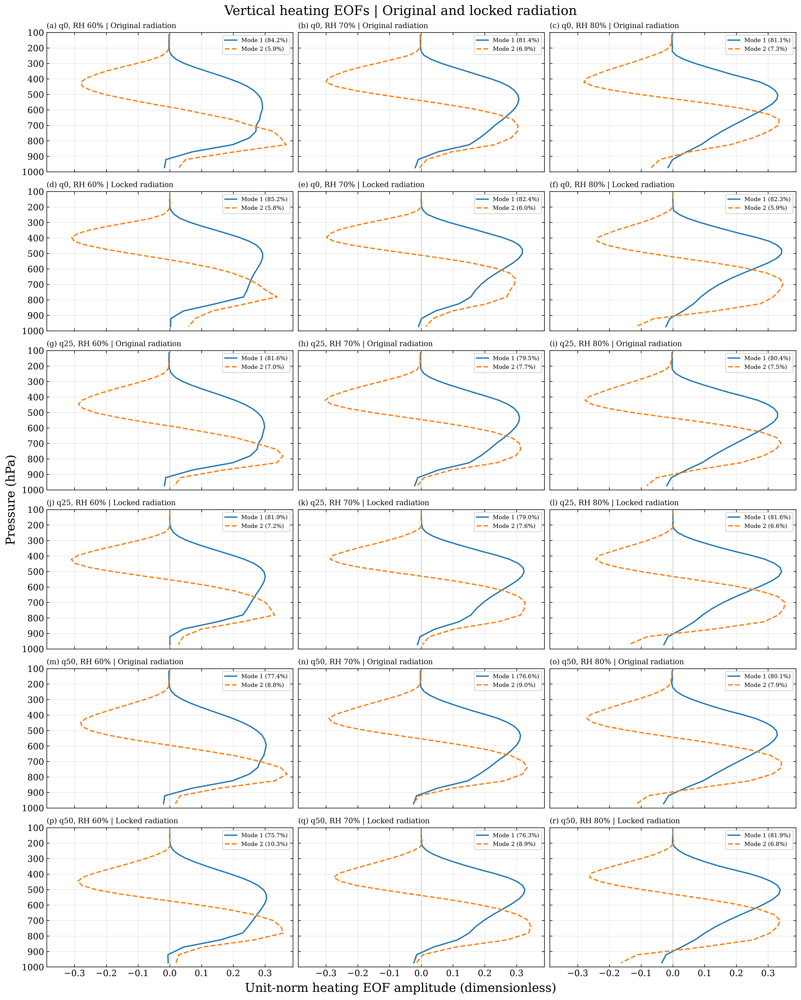
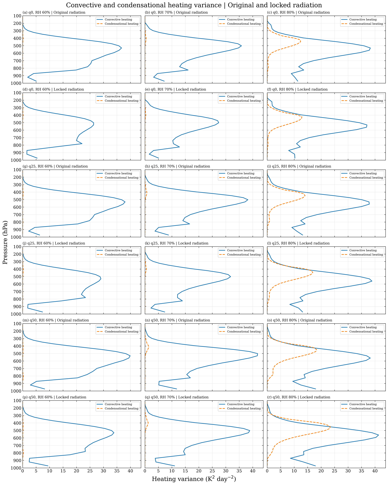

EOF and Heating Variance Profile
===

Experiment Setup
---

|**Time**|Duration|
|:---:|:---:|
|Simulation|5400 days (15 model years)|
|Spin-up|1800 days (5 model years)|

|**Experiment Controlling Factor**|Factor Range|
|:---:|:---:|
|Q flux (MLD 1m)|0, 25 ,50|
|SBM RH (%)|60, 70, 80|
|Byrne Radiation|original, locked|

Results
---

- As the RH increase, the top-heaviness of EOF 1 increase.
- When RH increase, the variance of condensational heating in upper-troposphere increase.

EOF of diabatic heating
---

Diabatic Heating Variance
---

