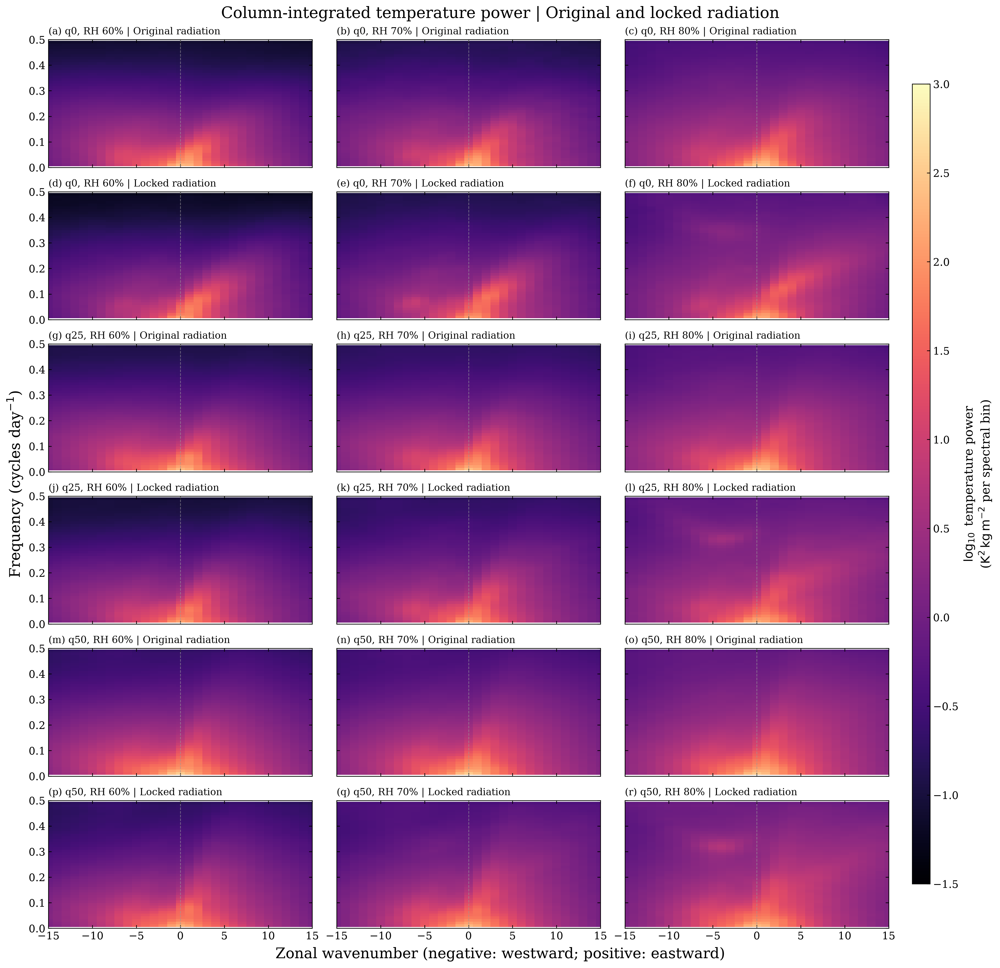
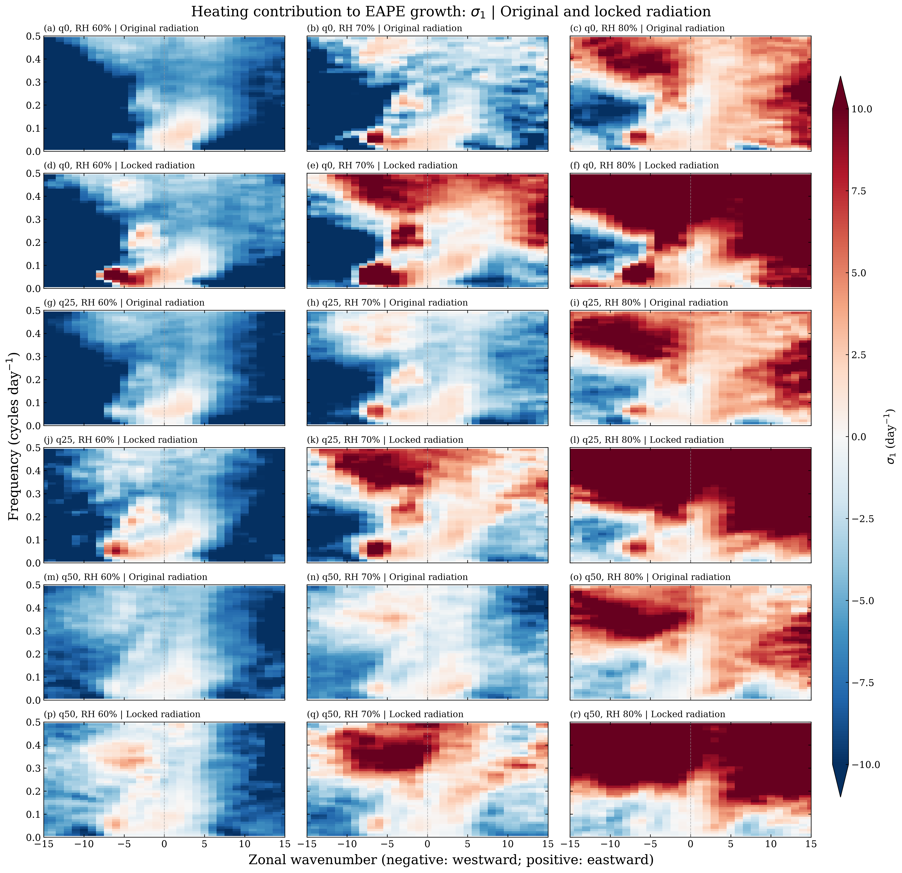
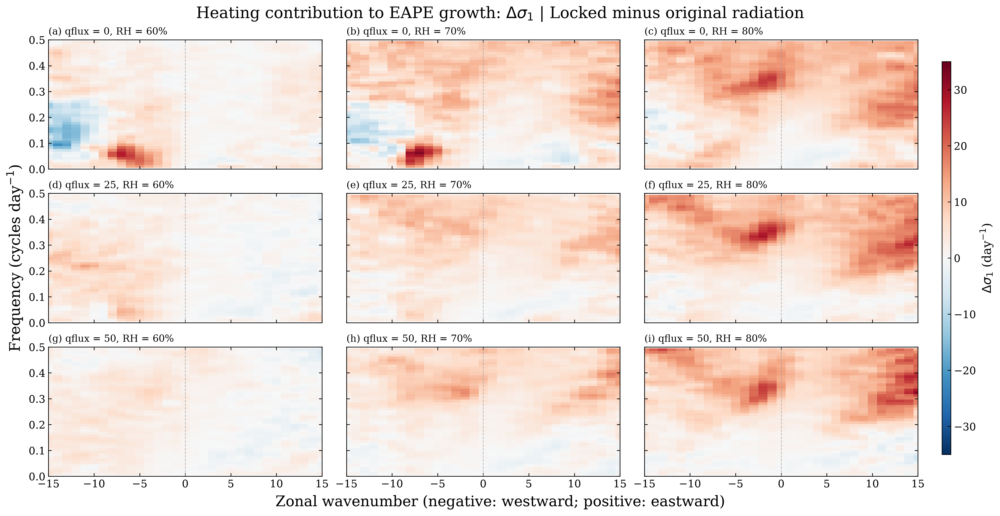
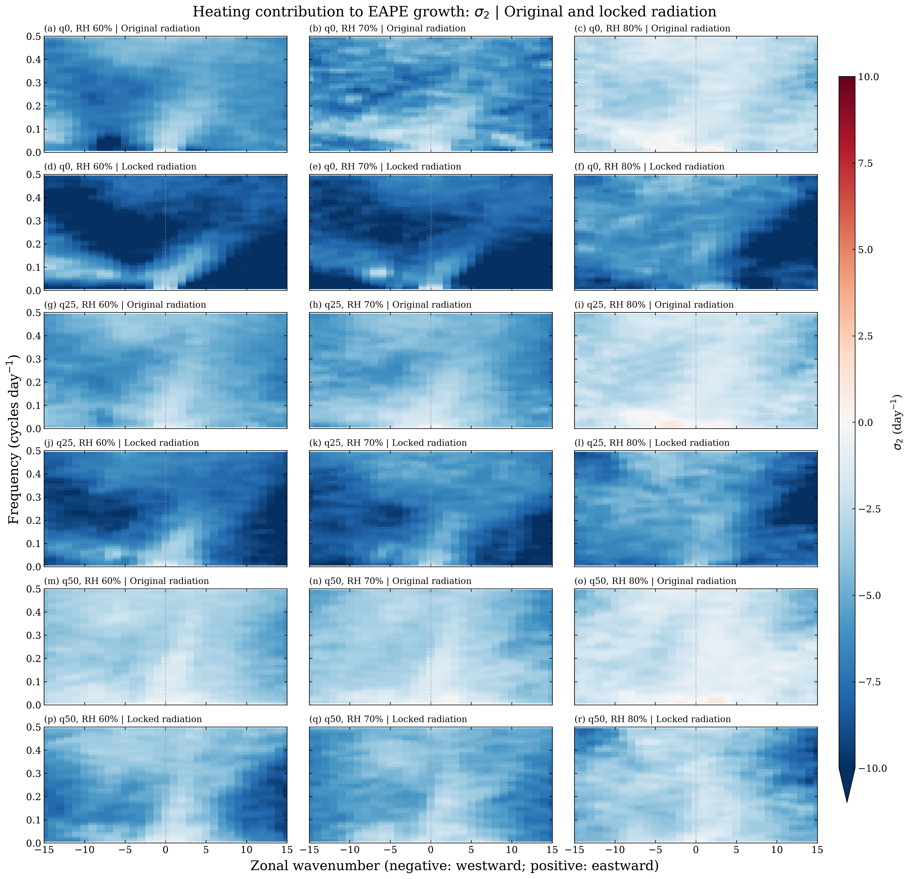
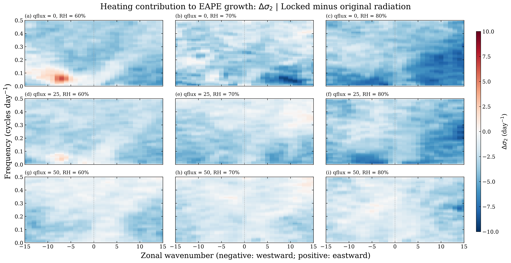

Power Spectrum Analysis
===

Experiment Setup
---

|**Time**|Duration|
|:---:|:---:|
|Simulation|5400 days (15 model years)|
|Spin-up|1800 days (5 model years)|

|**Experiment Controlling Factor**|Factor Range|
|:---:|:---:|
|Q flux (MLD 1m)|0, 25 ,50|
|SBM RH (%)|60, 70, 80|
|Byrne Radiation|original, locked|

Spectral Analysis Procedure
---

- Following Chien and Kim (2023), the preprocessing is as follow:
  - Chunk size: 96 days
  - Chunk overlap: 60 days
  - tap the first and last 5 days preventing Gibbs phenomenon

- The tropical band is set as: $5^\circ S \sim 5^\circ N$.

- Empirical orthogonal function associated with diabatic heating(`tdt_tg_convection` + `tdt_tg_condensation` + `tdt_tg_diffusion` + `tdt_rad`) is constructed through SVD and used to decompose diabatic heating and anomalous temperature into the first and second principal components.

Power Spectrum
---

- Temperature perturbations is demonstrated in the spectral domain through first calculating temperature power spectrum at different vertical levels, and apply vertically integration over the spectrum.

- The EAPE growth rate within spectral domain is formulated as:
    $$
        \sigma_i = 2 \frac{\text{Re}[\langle Q^{f, k}_{1, i} T^{f, k}_{i} \rangle]}{\langle T^{f, k}_{i} T^{f, k}_{i} \rangle}
    $$

- The difference in temperature power spectrum shows a clear signal that, when the moisture-radiation feedback is deactivated, the temperature variance over gravity-wave-mode disturbances is enhanced.

    Figure 1. Power spectrum of temperature perturbations at different experiments. The first, second, and third column represent the SBM RH as 60%, 70%, 80%, respectively. Figure (a)~(c), (g)~(i), and (m)~(o) represent original Byrne radiation, while Figure (d)~(f), (j)~(l), and (p)~(r) represents the locked radiation with fixed moisture profile for radiation

    Figure 2. Difference of log temperature power spectrum between locked experiment and origional experiments (shading) and log temperature power spectrum (contour) at each RH and Q-flux experiments. For each row, the Q-flux is fixed, and for each column, the SBM RH is fixed.

Growth Rate Analysis
---

- The locked moisture-radiation feedback show enhanced first-mode growth rate in all conditions over most of the wave bands.

    Figure 3. Similar to Figure 1, but for EAPE growth rate of the first baroclinic mode.

    Figure 4. Similar to Figure 2, but for EAPE growth rate of the first baroclinic mode.

    Figure 5. Similar to Figure 1, but for EAPE growth rate of the second baroclinic mode.

    Figure 6. Similar to Figure 2, but for EAPE growth rate of the second baroclinic mode.

