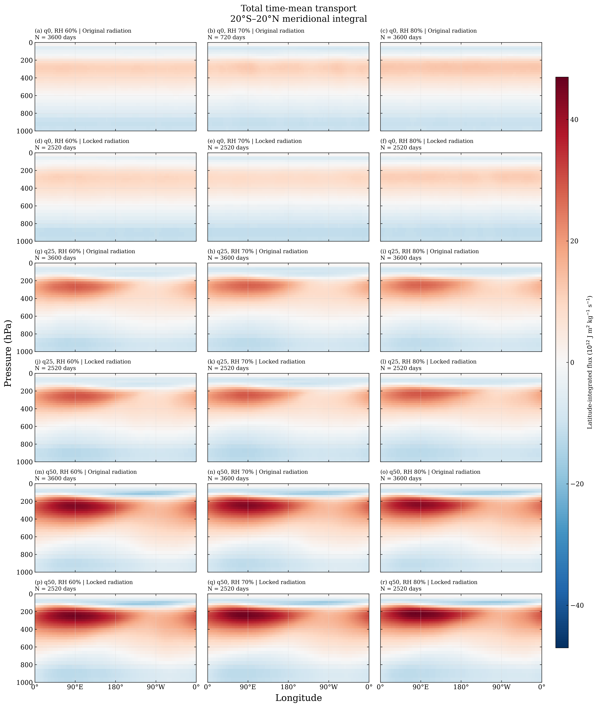
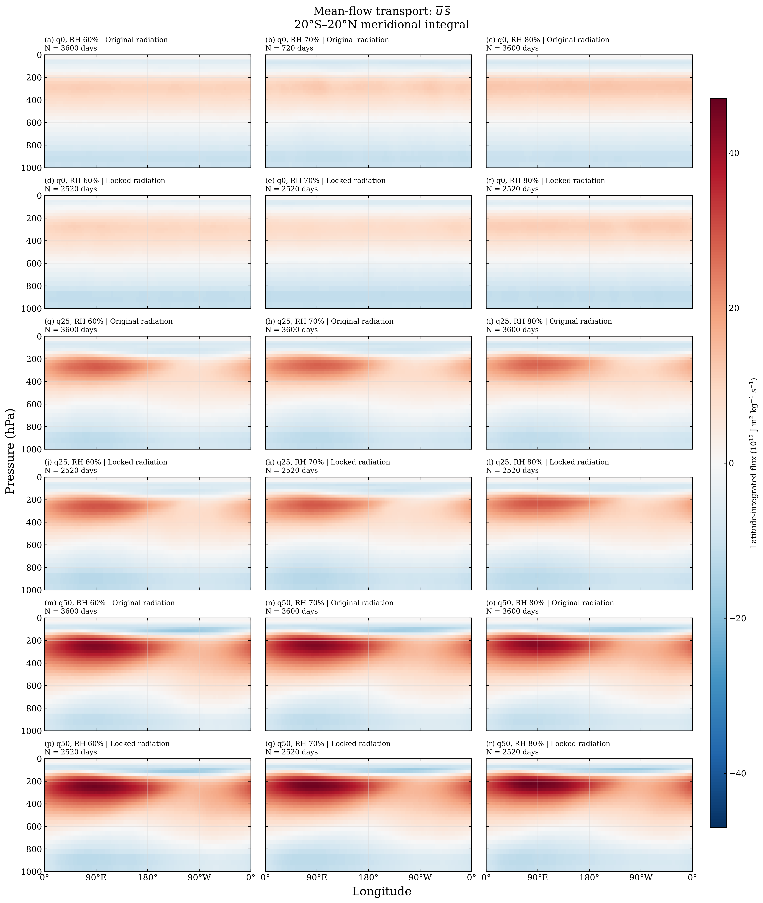
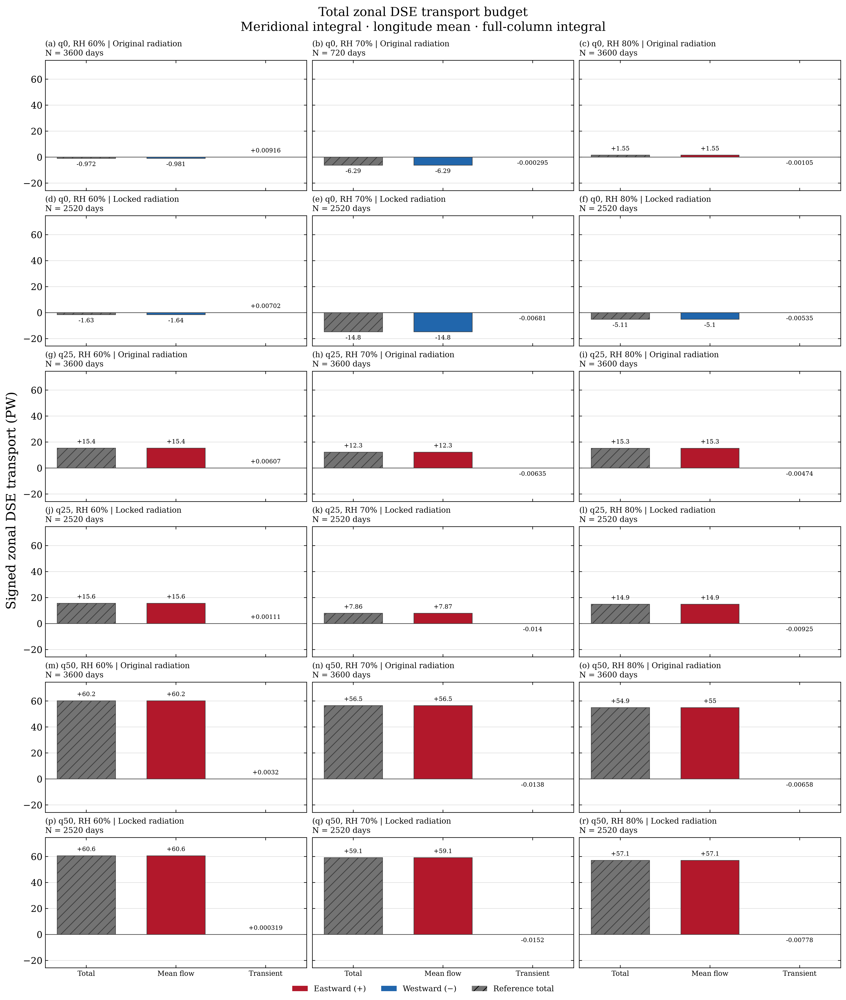
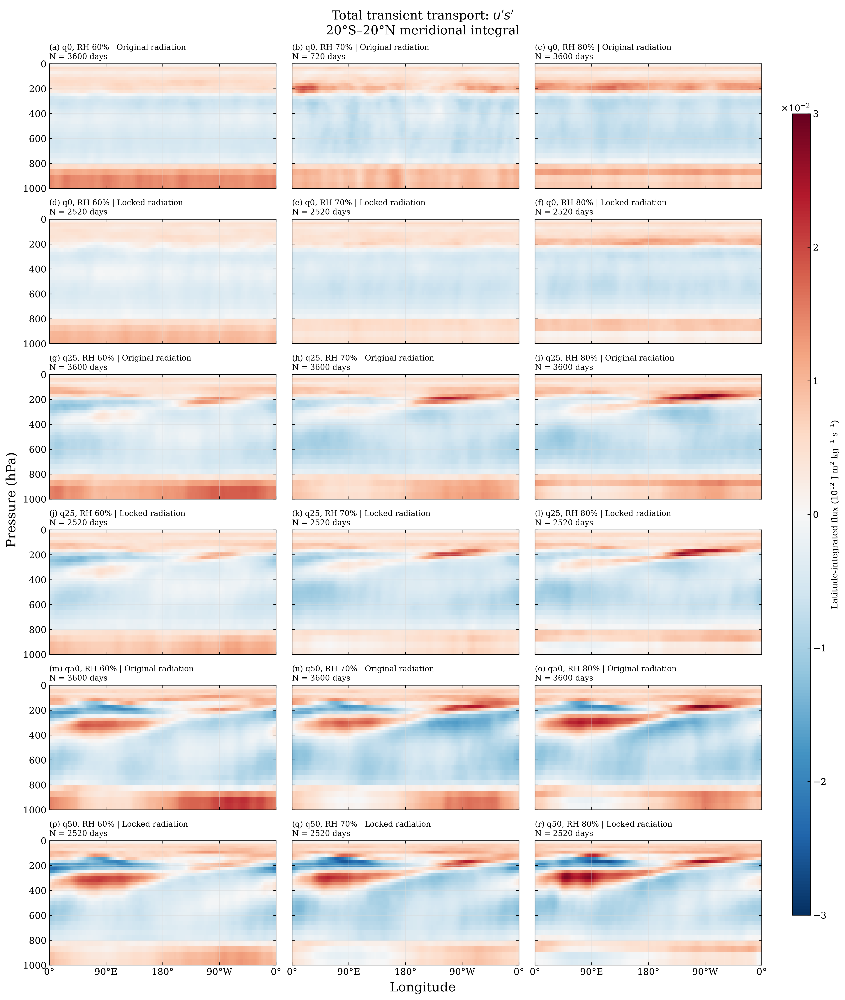
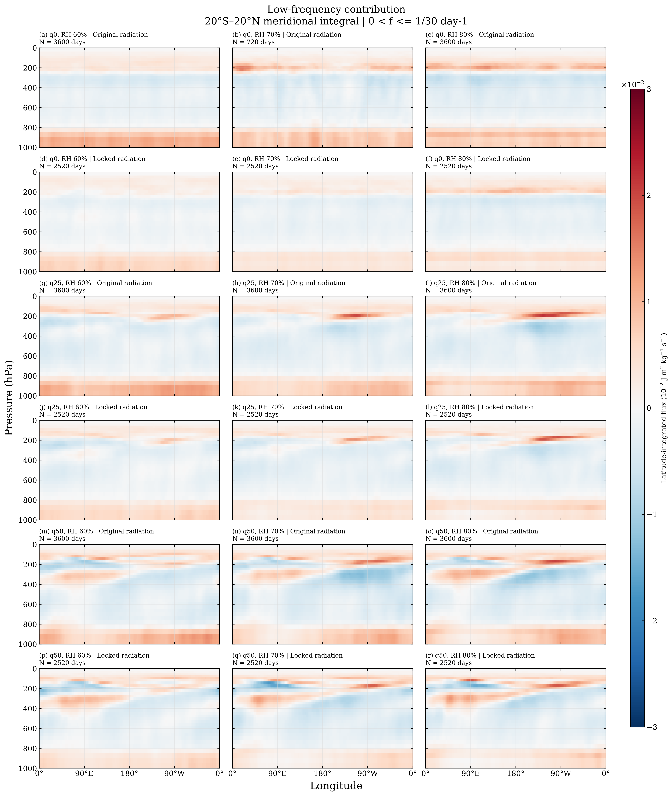
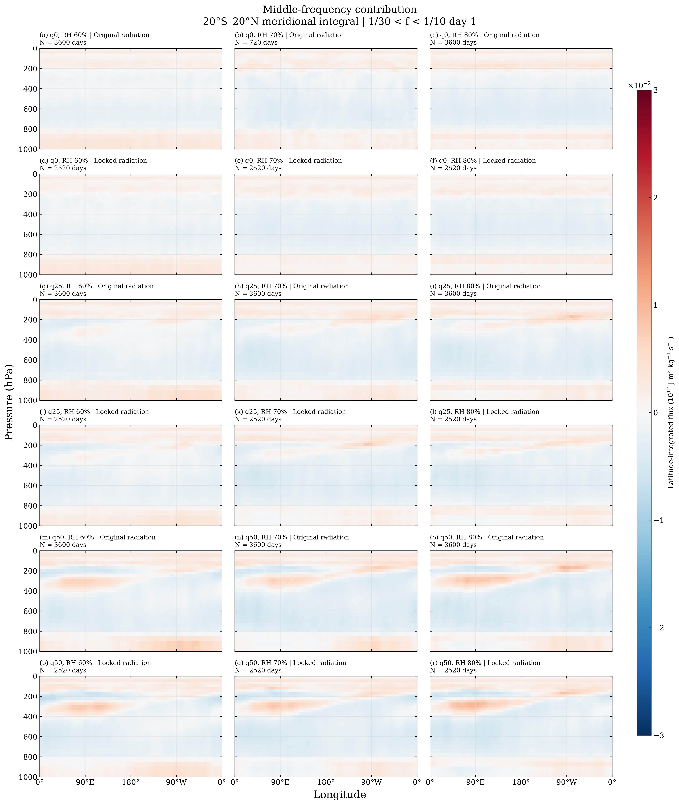
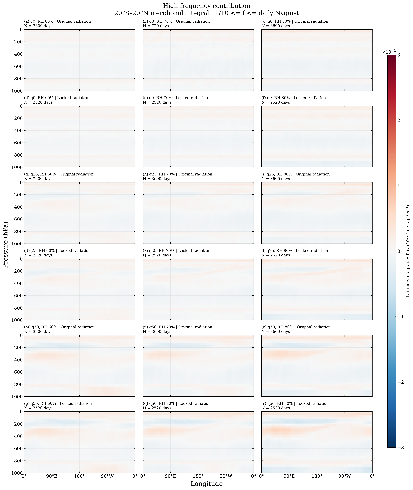
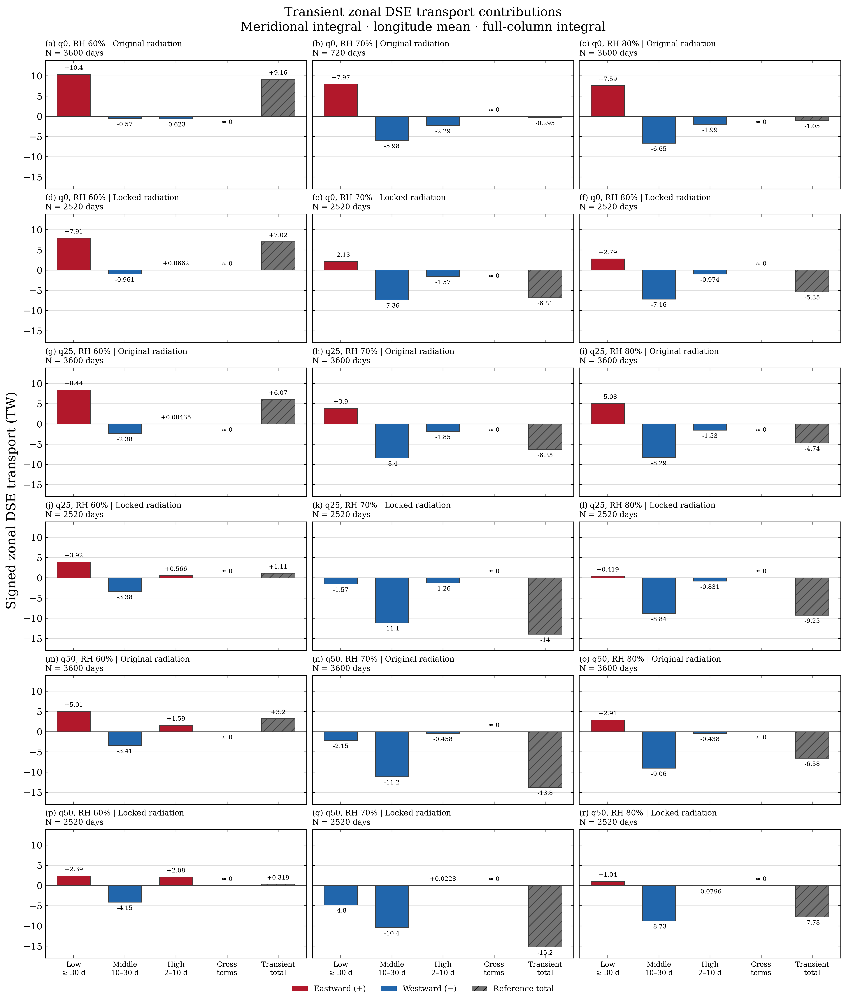

Zonal Dry Static Energy Transport Analysis
===

Experiment Setup
---

|**Time**|Duration|
|:---:|:---:|
|Initial records discarded from each input|1800 days (5 model years)|
|Retained analysis period: original radiation|3600 days (10 model years), except Q flux 0 / RH 70%|
|Retained analysis period: original radiation, Q flux 0 / RH 70%|720 days (2 model years)|
|Retained analysis period: locked radiation|2520 days (7 model years)|

|**Experiment Controlling Factor**|Factor Range|
|:---:|:---:|
|Q flux (MLD 1m)|0, 25, 50|
|SBM RH (%)|60, 70, 80|
|Byrne Radiation|original, locked|

- All 18 combinations are compared. Locked radiation uses a fixed moisture profile in the radiation calculation, deactivating the moisture–radiation feedback.

- The saved diagnostics use a 360-day calendar. Original-radiation averages cover model days 1800.5–5399.5, except Q flux 0 / RH 70%, which covers days 1800.5–2519.5. Locked-radiation averages cover days 7200.5–9719.5. Comparisons therefore use different averaging periods and record lengths, which also affect the lowest resolved frequency.

Zonal Transport Analysis Procedure
---

- Dry static energy (DSE) is defined as $s = c_p T + gz$, and its zonal transport is calculated from the product of zonal wind $u$ and DSE. Height is obtained by dry hydrostatic integration, with $z = 0$ at the lowest native full model level.

- Daily wind and DSE are each separated into their full-record time mean and three disjoint temporal frequency bands using FFT filtering. The entire retained record is used without segmentation, tapering, or additional detrending.

|**Component**|Period $P$|Frequency $f$ (day$^{-1}$)|
|:---:|:---:|:---:|
|Mean flow|Time mean|$f = 0$|
|Low frequency|$P \geq 30$ days|$0 < f \leq 1/30$|
|Middle frequency|$10 < P < 30$ days|$1/30 < f < 1/10$|
|High frequency|$2 \leq P \leq 10$ days|$1/10 \leq f \leq 1/2$|

- All 16 products of the four wind and DSE components are retained. With overbars denoting the retained-record time mean, the decomposition is

    $$
        \overline{us}
        = \overline{u}\,\overline{s}
        + \sum_{b \in \{L,M,H\}} \overline{u_b s_b}
        + C_{\mathrm{cross}},
        \qquad
        \overline{u's'} = \overline{us} - \overline{u}\,\overline{s}.
    $$

    Here, $C_{\mathrm{cross}}$ contains all off-diagonal products, including mean–band products. The transient contribution is the covariance about the time mean.

- Products are calculated at each grid point before integration over $20^\circ S$–$20^\circ N$. The longitude–pressure maps show $F(p,\lambda) = \int \overline{us}\,a\,d\phi$, or the corresponding component, in J m$^2$ kg$^{-1}$ s$^{-1}$. This meridional integral uses latitude-strip widths without normalization or a cosine factor.

- The bar plots additionally integrate over the full native atmospheric column using layer masses $\Delta p/g$, then average over longitude:

    $$
        \mathcal{T}
        = \left\langle \sum_j F(p_j,\lambda)\frac{\Delta p_j}{g} \right\rangle_\lambda.
    $$

    These signed transports are expressed in PW for the overall budget and TW for the transient components ($1\ \mathrm{PW} = 1000\ \mathrm{TW}$). Positive values indicate eastward transport; negative values indicate westward transport. Transport direction alone does not identify disturbance propagation direction.

- Calculations follow [zonal_energy_transpose.py](https://github.com/JosephKan828/Isca_Analysis/blob/main/Code/zonal_energy_transpose.py), with figures collected in [Zonal_DSE_transport.ipynb](https://github.com/JosephKan828/Isca_Analysis/blob/main/Code/plot/Zonal_DSE_transport.ipynb).

Mean-flow and Total Transport
---

- Total transport closely follows mean-flow transport in all experiments. The maps show an eastward branch around 200–400 hPa and a westward branch in the lower troposphere. Their partial cancellation determines the signed column integral.

- Increasing Q flux strengthens the eastward upper-tropospheric branch, particularly near $90^\circ E$, and increases the net eastward column transport at every RH and radiation setting. The longitude dependence is weak at Q flux 0 and becomes pronounced at Q flux 25 and 50.

- The column-integrated total ranges from approximately $-14.84$ to $+1.55$ PW at Q flux 0, $+7.86$ to $+15.63$ PW at Q flux 25, and $+54.95$ to $+60.61$ PW at Q flux 50. At Q flux 0, all cases are net westward except the original-radiation RH 80% case.

    Figure 1. Time-mean zonal DSE transport integrated over 20°S–20°N, shown against longitude and pressure. Columns represent SBM RH of 60%, 70%, and 80%. Paired rows show original and locked radiation for Q flux 0, 25, and 50, respectively: panels (a)–(c), (g)–(i), and (m)–(o) use original radiation; panels (d)–(f), (j)–(l), and (p)–(r) use locked radiation. Red indicates eastward transport and blue indicates westward transport. N gives the retained number of daily samples.

    Figure 2. As in Figure 1, but for transport by the time-mean wind and DSE. Figures 1 and 2 share the same color scale.

    Figure 3. Total, mean-flow, and transient zonal DSE transport after meridional integration, full-column mass integration, and longitude averaging, in PW. The experiment layout follows Figure 1. Hatched bars show the total, which equals the sum of the mean-flow and transient contributions.

Transient Transport and Frequency Contributions
---

- Net transient transport is much smaller than mean-flow transport: its magnitude is below 1% of the total in every experiment. Nevertheless, the transient maps contain distinct eastward and westward regions that partly cancel during column integration and longitude averaging.

- RH 60% produces net eastward transient transport at every Q flux and radiation setting, whereas RH 70% and 80% produce net westward transient transport. Increasing Q flux generally shifts net transient transport westward; the exception is locked radiation at RH 80%, where transport changes from $-9.25$ to $-7.78$ TW between Q flux 25 and 50. RH 70% has the strongest westward transient transport at Q flux 25 and 50, so the RH response is not monotonic.

- Low-frequency transport is generally eastward, with net contributions from $-4.80$ to $+10.36$ TW. Its eastward contribution generally decreases as Q flux increases, except for a recovery from $+0.42$ to $+1.04$ TW between Q flux 25 and 50 under locked radiation at RH 80%. It becomes westward at Q flux 50 / RH 70% under both radiation settings and at Q flux 25 / RH 70% under locked radiation.

- Middle-frequency transport is net westward in all 18 experiments, ranging from $-11.16$ to $-0.57$ TW. It supplies the largest westward band contribution in the RH 70% and 80% cases. The high-frequency contribution is smaller, ranging from $-2.29$ to $+2.08$ TW, and can have either sign.

- The transient maps show eastward transport near the surface and in parts of the upper troposphere, with broad westward transport at intermediate levels. At Q flux 50, the upper-tropospheric pattern varies strongly with longitude, including opposing contributions around 200 and 300 hPa near $90^\circ E$.

    Figure 4. As in Figure 1, but for total transient transport. Figures 4–7 share a common color scale, separate from the mean-flow and total-transport scale in Figures 1 and 2.

    Figure 5. As in Figure 4, but for the same-band wind–DSE covariance at periods of at least 30 days.

    Figure 6. As in Figure 4, but for the same-band wind–DSE covariance at periods strictly between 10 and 30 days.

    Figure 7. As in Figure 4, but for the same-band wind–DSE covariance at resolved periods of 2–10 days.

Radiation Feedback and the Transient Budget
---

- Locked radiation shifts net transient transport westward in all nine matched Q flux–RH pairs. The locked-minus-original difference ranges from $-7.61$ to $-1.20$ TW. At RH 60%, transport remains eastward but weakens; at RH 70% and 80%, westward transport strengthens.

- The low-frequency contribution shifts westward in every pair, by approximately 1.88–5.84 TW, and provides the largest band contribution to the net change. The high-frequency contribution shifts eastward in every pair, partly offsetting this change. Middle-frequency transport becomes more westward in seven pairs; Q flux 50 / RH 70% and RH 80% are the exceptions.

- The response of total transport to radiation locking varies with Q flux and RH because mean flow dominates the overall budget. For example, at Q flux 50, total eastward transport increases under locked radiation at all three RH values even though transient transport shifts westward.

|**Q flux**|**SBM RH (%)**|Transient: original (TW)|Transient: locked (TW)|Locked − original (TW)|
|:---:|:---:|:---:|:---:|:---:|
|0|60|+9.16|+7.02|−2.15|
|0|70|−0.30|−6.81|−6.51|
|0|80|−1.05|−5.35|−4.29|
|25|60|+6.07|+1.11|−4.95|
|25|70|−6.35|−13.96|−7.61|
|25|80|−4.74|−9.25|−4.51|
|50|60|+3.20|+0.32|−2.88|
|50|70|−13.76|−15.22|−1.46|
|50|80|−6.58|−7.78|−1.20|

- Cross terms are negligible: their combined column contribution has a magnitude below 0.05 W in every experiment, compared with TW-scale same-band contributions. This is consistent with disjoint Fourier bands averaged over the complete record. The relative column-budget residual in the saved table is below $10^{-15}$.

- These differences describe the available time averages. Their statistical significance has not been assessed, and the shorter original Q flux 0 / RH 70% record warrants particular care when comparing low-frequency transport.

    Figure 8. Column-integrated low-, middle-, high-frequency, cross-term, and net transient contributions, in TW. The experiment layout follows Figure 1. The hatched transient total equals the sum of the four component bars; cross terms are approximately zero.

